# Le muscle lisse, puis la physiologie du sang

12 schémas. Pour en afficher un dans le chat : ``.

## 0. Le fil du cours : on finit le muscle avec le muscle lisse, puis on passe aux liquides du corps et au sang.

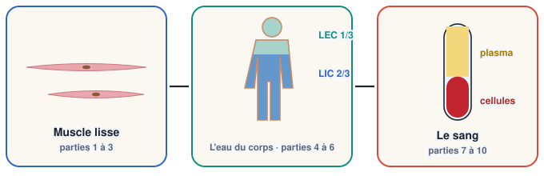

`https://cdn.jsdelivr.net/gh/alxhe3-lab/schemas-medecine@main/Physiologie/CM5/fig00-83aad7e9.svg`

## 1. Pourquoi le muscle lisse se contracte-t-il « en entier » ?

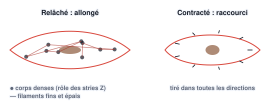

`https://cdn.jsdelivr.net/gh/alxhe3-lab/schemas-medecine@main/Physiologie/CM5/fig01-743e448c.svg`

## 2. Phasique ou tonique : à quoi ressemble la force dans le temps ?

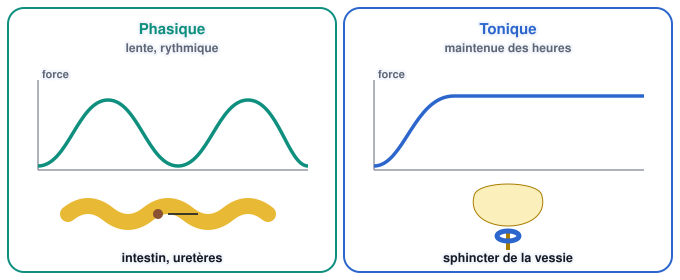

`https://cdn.jsdelivr.net/gh/alxhe3-lab/schemas-medecine@main/Physiologie/CM5/fig02-9ae91f38.svg`

## 3. Comment la stimulation gagne-t-elle les cellules voisines ?

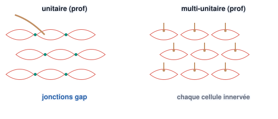

`https://cdn.jsdelivr.net/gh/alxhe3-lab/schemas-medecine@main/Physiologie/CM5/fig03-41ddfc67.svg`

## 4. Comment l'eau d'un homme de 70 kg se répartit-elle ?

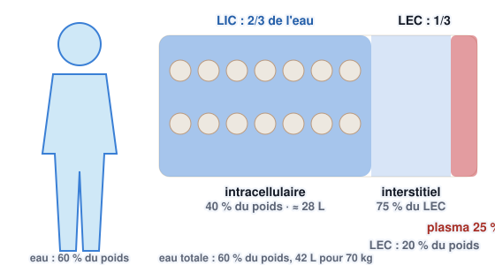

`https://cdn.jsdelivr.net/gh/alxhe3-lab/schemas-medecine@main/Physiologie/CM5/fig04-79574aeb.svg`

## 5. Le blanc d'œuf : pourquoi un gel ne passe-t-il pas dans une passoire ?

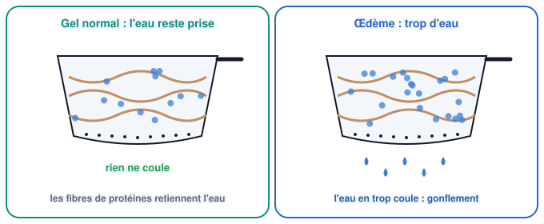

`https://cdn.jsdelivr.net/gh/alxhe3-lab/schemas-medecine@main/Physiologie/CM5/fig05-81aae0ad.svg`

## 6. Pourquoi une diarrhée est-elle si grave chez le nourrisson ?

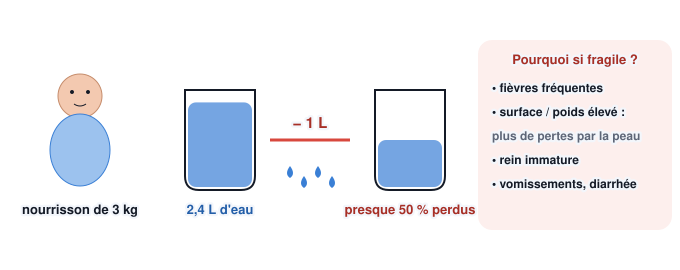

`https://cdn.jsdelivr.net/gh/alxhe3-lab/schemas-medecine@main/Physiologie/CM5/fig06-1232b39d.svg`

## 7. Quels sont les six rôles du sang ?

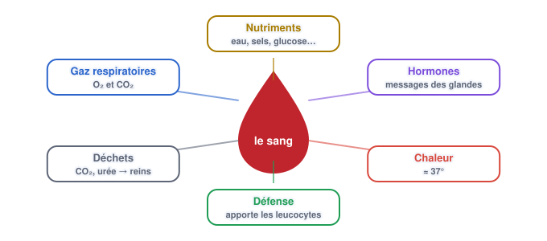

`https://cdn.jsdelivr.net/gh/alxhe3-lab/schemas-medecine@main/Physiologie/CM5/fig07-2c7624fc.svg`

## 8. Comment le sang garde-t-il la température à 37° ?

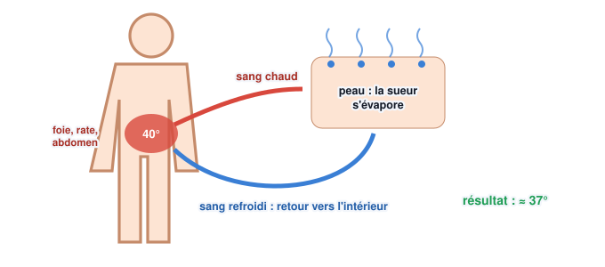

`https://cdn.jsdelivr.net/gh/alxhe3-lab/schemas-medecine@main/Physiologie/CM5/fig08-7067da24.svg`

## 9. Le tube après sédimentation : trois couches

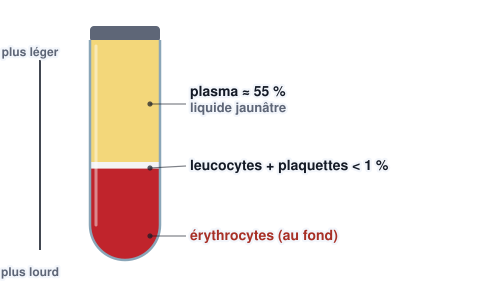

`https://cdn.jsdelivr.net/gh/alxhe3-lab/schemas-medecine@main/Physiologie/CM5/fig09-62690e81.svg`

## 10. Où l'hémoglobine se charge-t-elle et où donne-t-elle l'oxygène ?

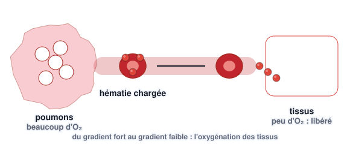

`https://cdn.jsdelivr.net/gh/alxhe3-lab/schemas-medecine@main/Physiologie/CM5/fig10-b4da187f.svg`

## 11. Pourquoi le corps perd-il si peu de fer ? Parce qu'il le recycle.

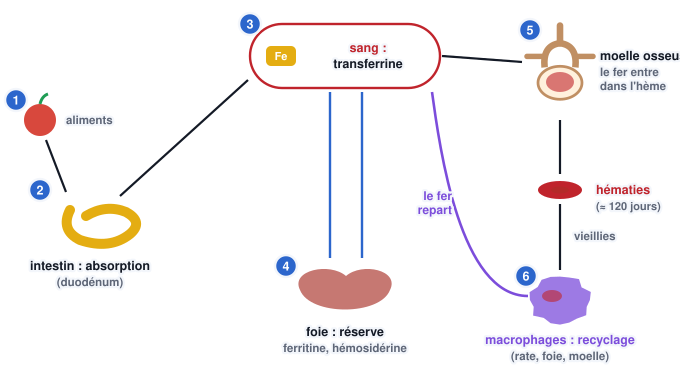

`https://cdn.jsdelivr.net/gh/alxhe3-lab/schemas-medecine@main/Physiologie/CM5/fig11-5c990f9b.svg`
