# Hémoglobine, groupes sanguins et début de l'hémostase

13 schémas. Pour en afficher un dans le chat : ``.

## 0. Le fil du cours : l'hématie naît dans la moelle, transporte les gaz grâce à l'hémoglobine, meurt dans la rate ; ses antigènes décident de la transfusion.

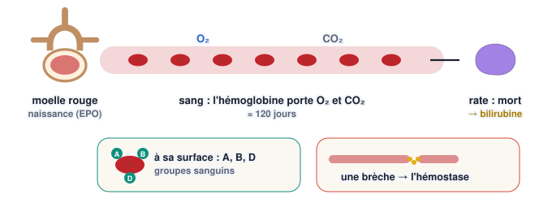

`https://cdn.jsdelivr.net/gh/alxhe3-lab/schemas-medecine@main/Physiologie/CM6/fig00-e84dbd81.svg`

## 1. Pourquoi 4 chaînes et 4 hèmes ? Chaque chaîne enveloppe un hème.

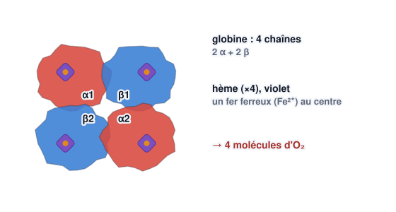

`https://cdn.jsdelivr.net/gh/alxhe3-lab/schemas-medecine@main/Physiologie/CM6/fig01-8c89b0b9.svg`

## 2. Pourquoi une courbe en S plutôt qu'une droite ?

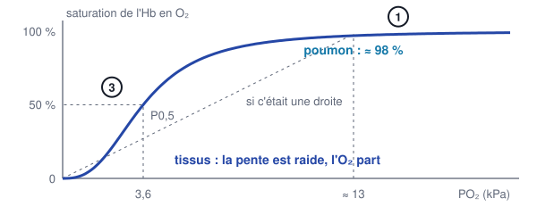

`https://cdn.jsdelivr.net/gh/alxhe3-lab/schemas-medecine@main/Physiologie/CM6/fig02-57daf1d2.svg`

## 3. Où se trouve le sang sur l'échelle du pH ?

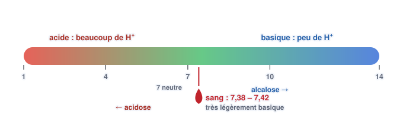

`https://cdn.jsdelivr.net/gh/alxhe3-lab/schemas-medecine@main/Physiologie/CM6/fig03-628833b0.svg`

## 4. Dans quel sens va le CO₂, aux tissus puis au poumon ?

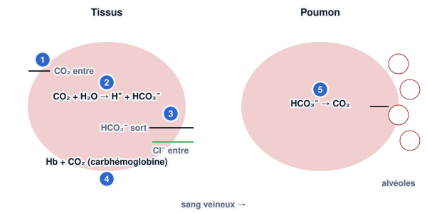

`https://cdn.jsdelivr.net/gh/alxhe3-lab/schemas-medecine@main/Physiologie/CM6/fig04-2c52066d.svg`

## 5. Le même hème, trois états : un seul transporte l'O₂

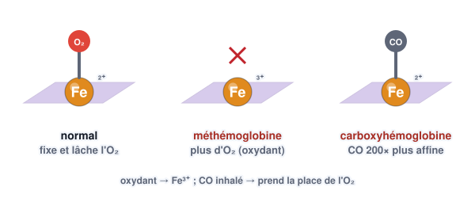

`https://cdn.jsdelivr.net/gh/alxhe3-lab/schemas-medecine@main/Physiologie/CM6/fig05-cf3e4431.svg`

## 6. Comment le rein corrige-t-il un manque d'oxygène ?

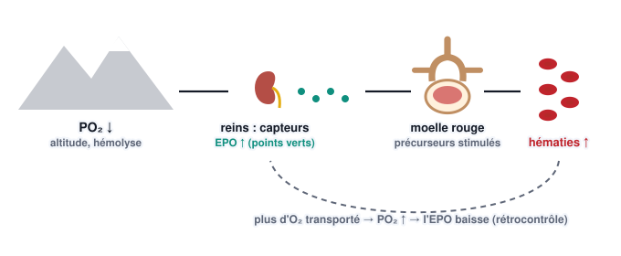

`https://cdn.jsdelivr.net/gh/alxhe3-lab/schemas-medecine@main/Physiologie/CM6/fig06-f5a361b6.svg`

## 7. Où part la bilirubine, et quelle couleur donne-t-elle ?

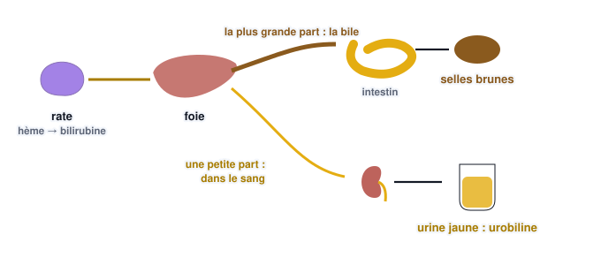

`https://cdn.jsdelivr.net/gh/alxhe3-lab/schemas-medecine@main/Physiologie/CM6/fig07-85e61d8e.svg`

## 8. Trois tailles d'hématies : laquelle est normale ?

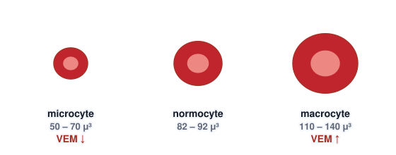

`https://cdn.jsdelivr.net/gh/alxhe3-lab/schemas-medecine@main/Physiologie/CM6/fig08-d3de6201.svg`

## 9. Que fait le receveur selon les papiers du greffon ?

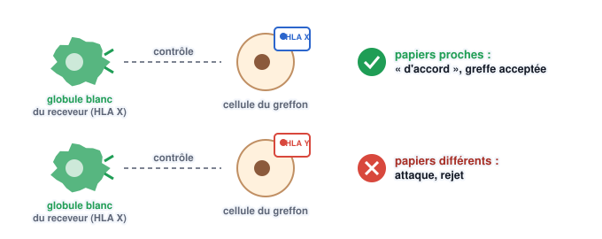

`https://cdn.jsdelivr.net/gh/alxhe3-lab/schemas-medecine@main/Physiologie/CM6/fig09-7052fe6b.svg`

## 10. Dans quel sens peut aller le sang ? (sens des flèches)

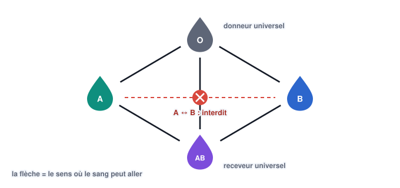

`https://cdn.jsdelivr.net/gh/alxhe3-lab/schemas-medecine@main/Physiologie/CM6/fig10-eb91d411.svg`

## 11. Pourquoi le 2e bébé Rh+ est-il en danger et pas le 1er ?

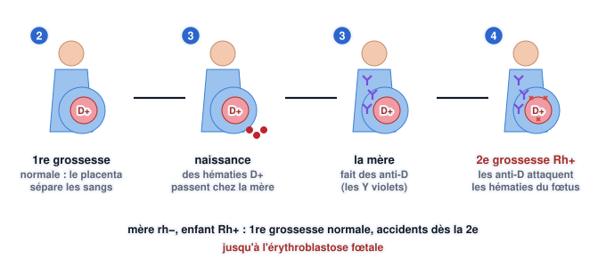

`https://cdn.jsdelivr.net/gh/alxhe3-lab/schemas-medecine@main/Physiologie/CM6/fig11-208a7ef8.svg`

## 12. Dans quel ordre, et que recouvre le mot « coagulation » ?

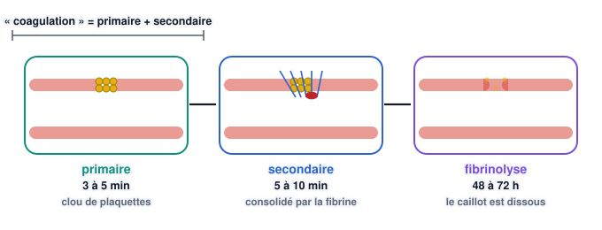

`https://cdn.jsdelivr.net/gh/alxhe3-lab/schemas-medecine@main/Physiologie/CM6/fig12-4b1be168.svg`
