# Hémostase et fonction défensive du sang

14 schémas. Pour en afficher un dans le chat : ``.

## 0. Le fil du cours : arrêter la fuite (plaquettes, fibrine), puis repousser les microbes (leucocytes, anticorps).

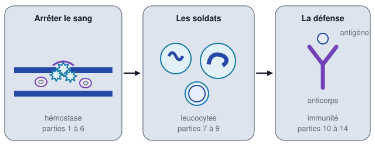

`https://cdn.jsdelivr.net/gh/alxhe3-lab/schemas-medecine@main/Physiologie/CM7/fig00-3c12a120.svg`

## 1. Dans quel ordre, et combien de temps ?

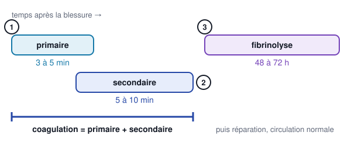

`https://cdn.jsdelivr.net/gh/alxhe3-lab/schemas-medecine@main/Physiologie/CM7/fig01-cea8de88.svg`

## 2. D'où vient la plaquette, et comment est-elle faite ?

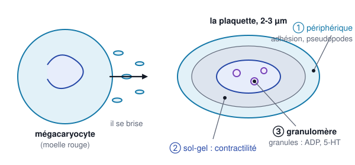

`https://cdn.jsdelivr.net/gh/alxhe3-lab/schemas-medecine@main/Physiologie/CM7/fig02-831a0a44.svg`

## 3. Que se passe-t-il, dans l'ordre, quand le vaisseau se rompt ?

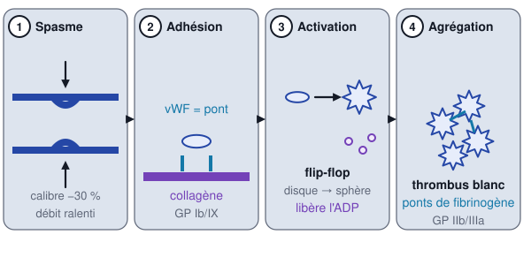

`https://cdn.jsdelivr.net/gh/alxhe3-lab/schemas-medecine@main/Physiologie/CM7/fig03-14c31026.svg`

## 4. Qui transforme quoi, à la fin de la cascade ?

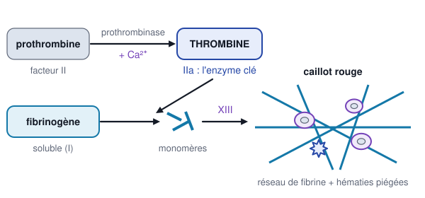

`https://cdn.jsdelivr.net/gh/alxhe3-lab/schemas-medecine@main/Physiologie/CM7/fig04-7c3fcf5c.svg`

## 5. Par où entre-t-on dans la cascade ?

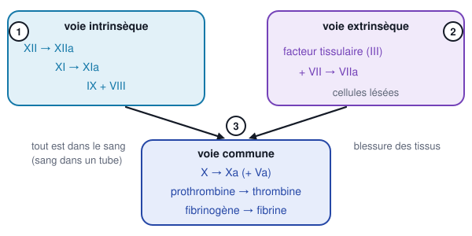

`https://cdn.jsdelivr.net/gh/alxhe3-lab/schemas-medecine@main/Physiologie/CM7/fig05-0c791203.svg`

## 6. Pourquoi le fils est-il malade et pas la mère ?

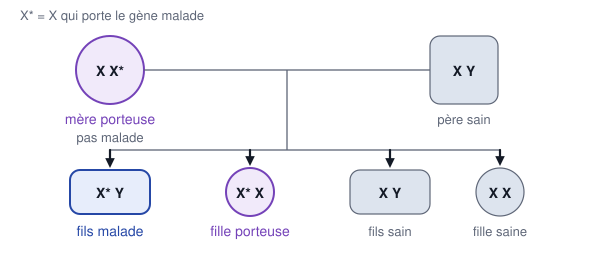

`https://cdn.jsdelivr.net/gh/alxhe3-lab/schemas-medecine@main/Physiologie/CM7/fig06-7e0eab87.svg`

## 7. Comment ranger les cinq leucocytes ?

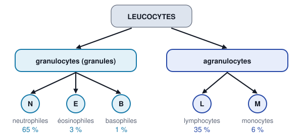

`https://cdn.jsdelivr.net/gh/alxhe3-lab/schemas-medecine@main/Physiologie/CM7/fig07-73f3d8b0.svg`

## 9. Comment un myéloblaste devient-il un granulocyte ?

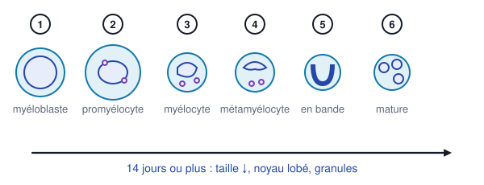

`https://cdn.jsdelivr.net/gh/alxhe3-lab/schemas-medecine@main/Physiologie/CM7/fig09-a6fc8c90.svg`

## 10. Quelles barrières le microbe doit-il franchir ?

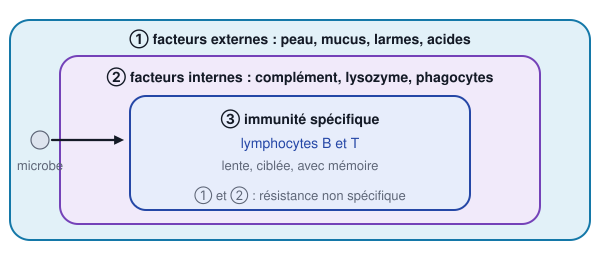

`https://cdn.jsdelivr.net/gh/alxhe3-lab/schemas-medecine@main/Physiologie/CM7/fig10-ce720a05.svg`

## 11. Comment le leucocyte passe-t-il du sang au tissu ?

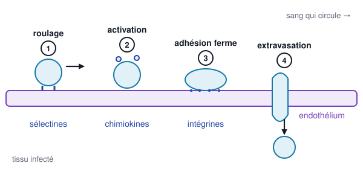

`https://cdn.jsdelivr.net/gh/alxhe3-lab/schemas-medecine@main/Physiologie/CM7/fig11-c48c4bf7.svg`

## 12. D'où viennent les cinq signes ?

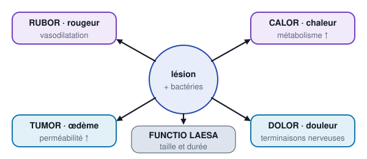

`https://cdn.jsdelivr.net/gh/alxhe3-lab/schemas-medecine@main/Physiologie/CM7/fig12-f357744e.svg`

## 13. Qui parle à qui pour fabriquer les anticorps ?

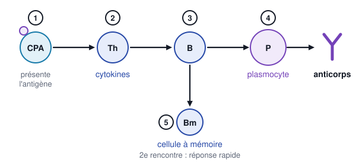

`https://cdn.jsdelivr.net/gh/alxhe3-lab/schemas-medecine@main/Physiologie/CM7/fig13-eb67d70c.svg`

## 14. Comment le complément tue-t-il une bactérie ?

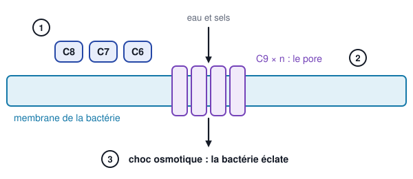

`https://cdn.jsdelivr.net/gh/alxhe3-lab/schemas-medecine@main/Physiologie/CM7/fig14-673ac5af.svg`
