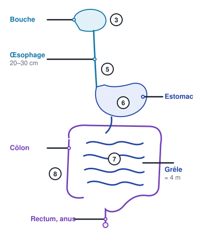
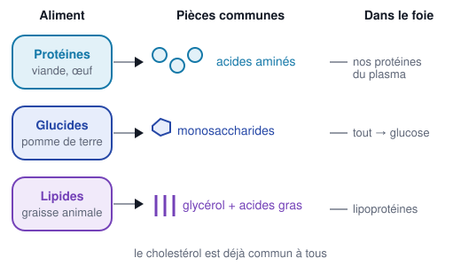
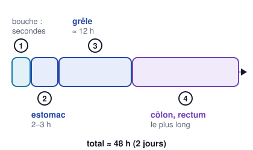
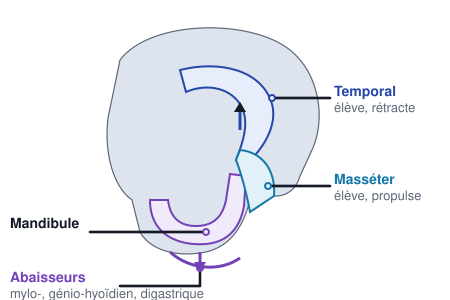
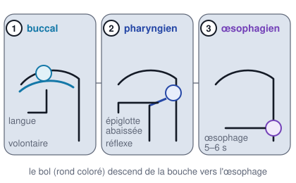
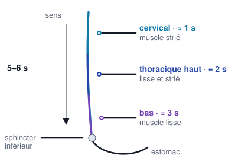
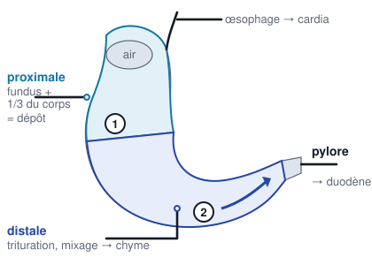
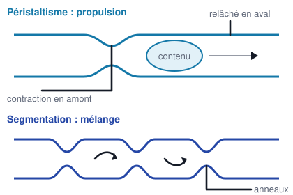
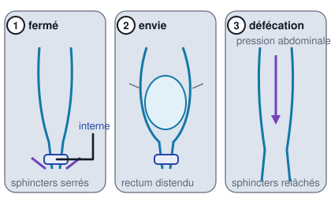
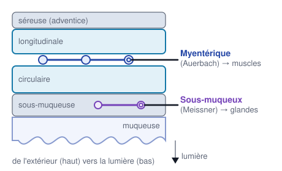

# Le tube digestif : rôle et mouvements

10 schémas. Pour en afficher un dans le chat : ``.

## 0. Le trajet des aliments ; les numéros renvoient aux parties du cours (≈ 6 m de tube, ≈ 2 jours de transit).

`https://cdn.jsdelivr.net/gh/alxhe3-lab/schemas-medecine@main/Physiologie/CM8/fig00-92ef8236.svg`

## 1. En quoi la digestion découpe-t-elle chaque aliment ?

`https://cdn.jsdelivr.net/gh/alxhe3-lab/schemas-medecine@main/Physiologie/CM8/fig01-9d932c6b.svg`

## 2. Combien de temps un aliment reste-t-il à chaque étage ?

`https://cdn.jsdelivr.net/gh/alxhe3-lab/schemas-medecine@main/Physiologie/CM8/fig02-f45951ed.svg`

## 3. Quels muscles ferment la bouche, lesquels l'ouvrent ?

`https://cdn.jsdelivr.net/gh/alxhe3-lab/schemas-medecine@main/Physiologie/CM8/fig03-111d2849.svg`

## 4. Où est le bol à chaque temps, et qu'est-ce qui ferme la trachée ?

`https://cdn.jsdelivr.net/gh/alxhe3-lab/schemas-medecine@main/Physiologie/CM8/fig04-62148d59.svg`

## 5. Combien de temps dans chaque tiers de l'œsophage, et avec quel muscle ?

`https://cdn.jsdelivr.net/gh/alxhe3-lab/schemas-medecine@main/Physiologie/CM8/fig05-5199c9b3.svg`

## 6. Quelle région stocke, quelle région broie ?

`https://cdn.jsdelivr.net/gh/alxhe3-lab/schemas-medecine@main/Physiologie/CM8/fig06-b9891843.svg`

## 7. Péristaltisme ou segmentation : lequel pousse, lequel mélange ?

`https://cdn.jsdelivr.net/gh/alxhe3-lab/schemas-medecine@main/Physiologie/CM8/fig07-5d961900.svg`

## 8. Qu'est-ce qui s'ouvre, qu'est-ce qui pousse ?

`https://cdn.jsdelivr.net/gh/alxhe3-lab/schemas-medecine@main/Physiologie/CM8/fig08-f15e20d3.svg`

## 9. Où sont les deux plexus, et que commande chacun ?

`https://cdn.jsdelivr.net/gh/alxhe3-lab/schemas-medecine@main/Physiologie/CM8/fig09-acb864fd.svg`
