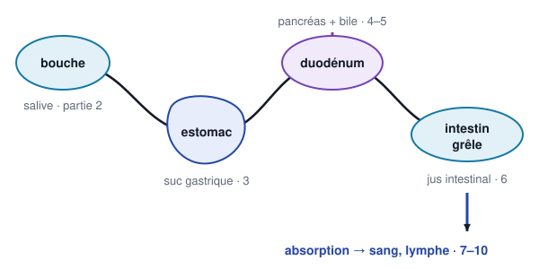
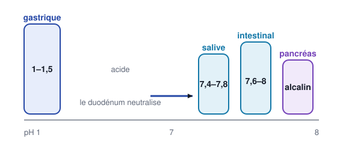
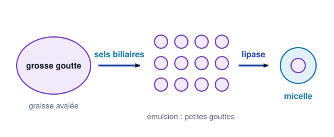
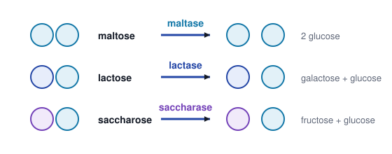

# Digestion chimique et absorption

4 schémas. Pour en afficher un dans le chat : ``.

## 0. De la bouche à l'intestin grêle : chaque étage ajoute sa sécrétion, l'absorption se fait dans l'intestin grêle.

`https://cdn.jsdelivr.net/gh/alxhe3-lab/schemas-medecine@main/Physiologie/CM9/fig00-ab82f19b.svg`

## 1. Seul l'estomac est acide

`https://cdn.jsdelivr.net/gh/alxhe3-lab/schemas-medecine@main/Physiologie/CM9/fig01-8a15f528.svg`

## 8. Émulsionner = casser la graisse en petites gouttes

`https://cdn.jsdelivr.net/gh/alxhe3-lab/schemas-medecine@main/Physiologie/CM9/fig08-31e9fae1.svg`

## 9. Chaque sucre double a son enzyme

`https://cdn.jsdelivr.net/gh/alxhe3-lab/schemas-medecine@main/Physiologie/CM9/fig09-d68232e5.svg`
