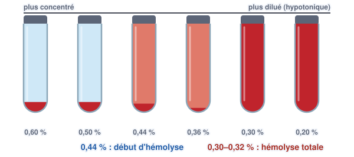
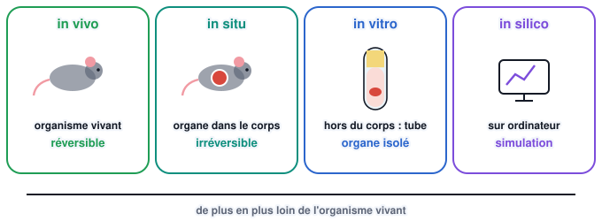
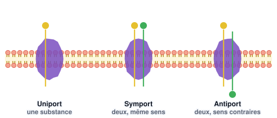
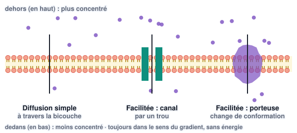
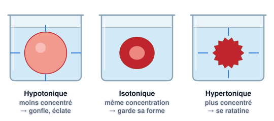
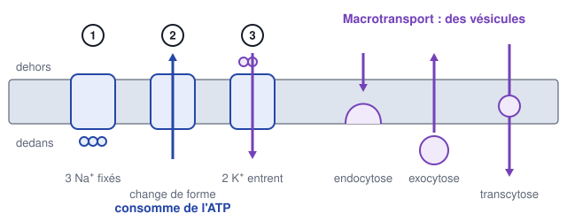
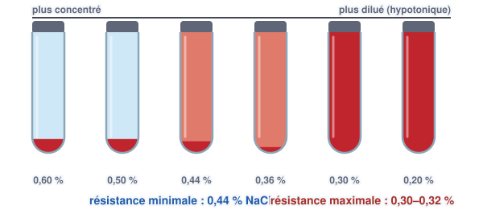
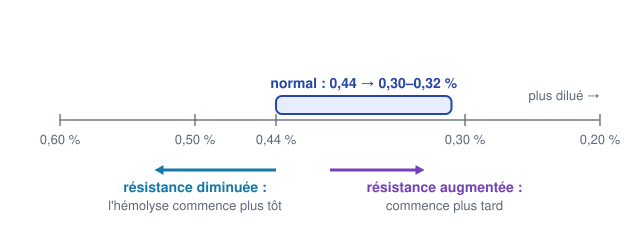

# Transport membranaire et résistance globulaire

8 schémas. Pour en afficher un dans le chat : ``.

## 0. L'expérience du jour : de gauche à droite, les solutions sont de plus en plus diluées et les globules rouges éclatent.

`https://cdn.jsdelivr.net/gh/alxhe3-lab/schemas-medecine@main/Physiologie/TP2/fig00-4291b00c.svg`

## 1. Où se passe l'expérience, et que devient l'organe ?

`https://cdn.jsdelivr.net/gh/alxhe3-lab/schemas-medecine@main/Physiologie/TP2/fig01-7069a96f.svg`

## 2. Combien de substances, et dans quel sens ?

`https://cdn.jsdelivr.net/gh/alxhe3-lab/schemas-medecine@main/Physiologie/TP2/fig02-67f0b2eb.svg`

## 3. Trois façons de passer sans énergie : lesquelles ?

`https://cdn.jsdelivr.net/gh/alxhe3-lab/schemas-medecine@main/Physiologie/TP2/fig03-ad7ebb95.svg`

## 4. Que devient le globule rouge dans chaque milieu ?

`https://cdn.jsdelivr.net/gh/alxhe3-lab/schemas-medecine@main/Physiologie/TP2/fig04-f8097ee4.svg`

## 5. Que fait la pompe, étape par étape ? Et les grosses particules ?

`https://cdn.jsdelivr.net/gh/alxhe3-lab/schemas-medecine@main/Physiologie/TP2/fig05-d259450a.svg`

## 6. Où commence et où finit l'hémolyse ?

`https://cdn.jsdelivr.net/gh/alxhe3-lab/schemas-medecine@main/Physiologie/TP2/fig06-c38ba242.svg`

## 7. Où se déplace le début de l'hémolyse ?

`https://cdn.jsdelivr.net/gh/alxhe3-lab/schemas-medecine@main/Physiologie/TP2/fig07-74f98632.svg`
