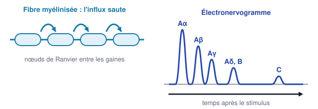
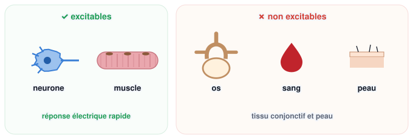
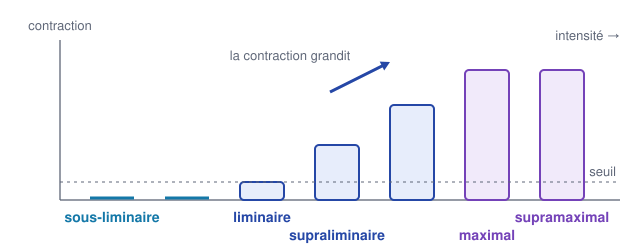
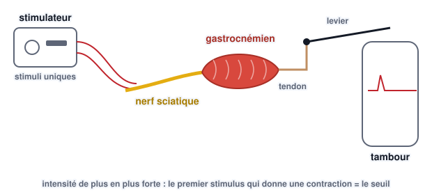
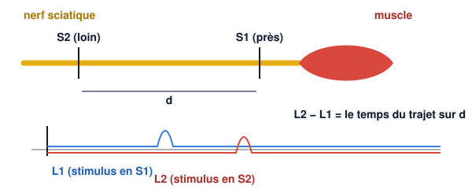
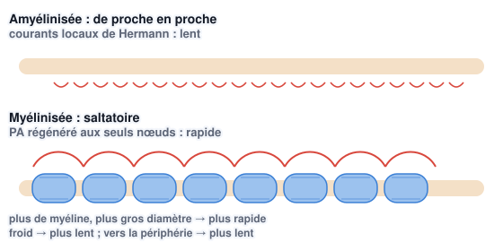
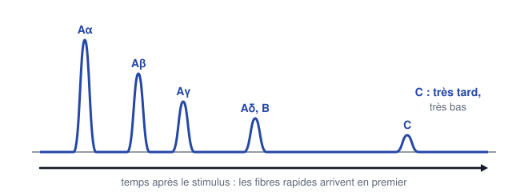

# Excitabilité et conduction du nerf et du muscle

7 schémas. Pour en afficher un dans le chat : ``.

## 0. À gauche, l'influx saute de nœud en nœud ; à droite, les fibres rapides (Aα) arrivent en premier, les fibres C en dernier.

`https://cdn.jsdelivr.net/gh/alxhe3-lab/schemas-medecine@main/Physiologie/TP3/fig00-654a08b0.svg`

## 1. Quelles cellules sont excitables ?

`https://cdn.jsdelivr.net/gh/alxhe3-lab/schemas-medecine@main/Physiologie/TP3/fig01-d9f367b1.svg`

## 2. Que fait le muscle quand l'intensité augmente ?

`https://cdn.jsdelivr.net/gh/alxhe3-lab/schemas-medecine@main/Physiologie/TP3/fig02-2687827a.svg`

## 3. Comment le nerf, le muscle et l'enregistreur sont-ils reliés ?

`https://cdn.jsdelivr.net/gh/alxhe3-lab/schemas-medecine@main/Physiologie/TP3/fig03-0db7a2f7.svg`

## 4. Pourquoi la latence L2 est-elle plus longue que L1 ?

`https://cdn.jsdelivr.net/gh/alxhe3-lab/schemas-medecine@main/Physiologie/TP3/fig04-08e568c2.svg`

## 5. Pourquoi la fibre myélinisée va-t-elle plus vite ?

`https://cdn.jsdelivr.net/gh/alxhe3-lab/schemas-medecine@main/Physiologie/TP3/fig05-938111d4.svg`

## 6. Dans quel ordre les fibres arrivent-elles aux électrodes ?

`https://cdn.jsdelivr.net/gh/alxhe3-lab/schemas-medecine@main/Physiologie/TP3/fig06-1fd1a1f5.svg`
