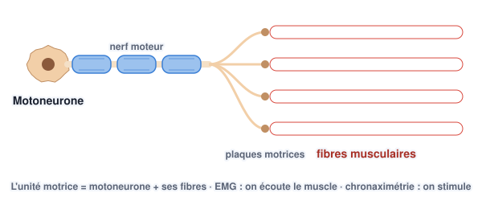
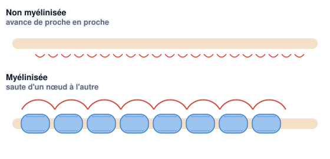
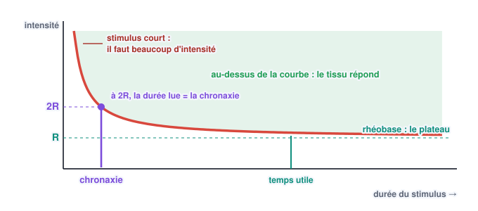
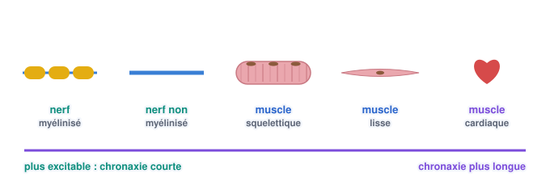

# EMG et chronaximétrie

4 schémas. Pour en afficher un dans le chat : ``.

## 0. L'EMG enregistre ce que fait le muscle ; la chronaximétrie stimule le nerf et cherche le plus petit stimulus efficace.

`https://cdn.jsdelivr.net/gh/alxhe3-lab/schemas-medecine@main/Physiologie/TP4/fig00-5016c4bd.svg`

## 1. Pourquoi la fibre myélinisée conduit-elle plus vite ?

`https://cdn.jsdelivr.net/gh/alxhe3-lab/schemas-medecine@main/Physiologie/TP4/fig01-9baa9f2a.svg`

## 5. La courbe force-durée : où lire la rhéobase (R) et la chronaxie (C) ?

`https://cdn.jsdelivr.net/gh/alxhe3-lab/schemas-medecine@main/Physiologie/TP4/fig05-25482098.svg`

## 8. Du plus excitable au moins excitable : qui a la chronaxie la plus courte ?

`https://cdn.jsdelivr.net/gh/alxhe3-lab/schemas-medecine@main/Physiologie/TP4/fig08-1de799d4.svg`
