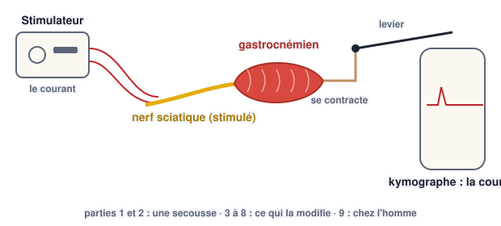
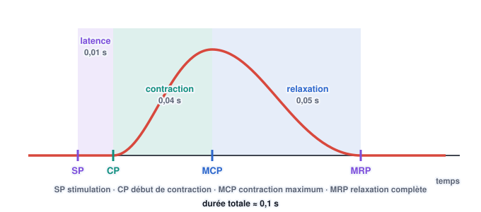
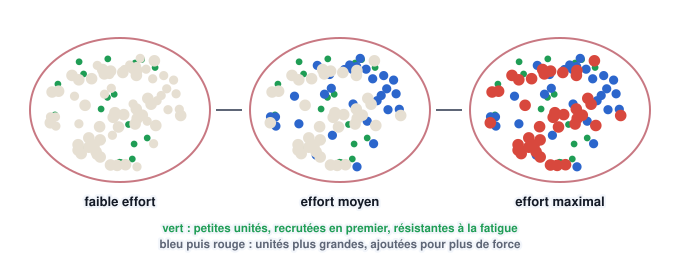
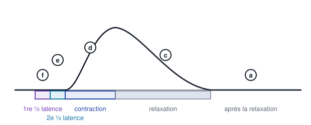
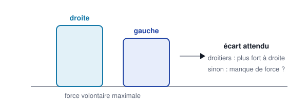

# La contraction du muscle squelettique

5 schémas. Pour en afficher un dans le chat : ``.

## 0. Le fil du TP : on stimule le nerf, le muscle se contracte, le kymographe dessine la courbe.

`https://cdn.jsdelivr.net/gh/alxhe3-lab/schemas-medecine@main/Physiologie/TP5/fig00-434bef49.svg`

## 3. Où sont les 4 points et les 3 phases sur la courbe ?

`https://cdn.jsdelivr.net/gh/alxhe3-lab/schemas-medecine@main/Physiologie/TP5/fig03-4b09ed66.svg`

## 4. Dans quel ordre les unités motrices sont-elles recrutées ?

`https://cdn.jsdelivr.net/gh/alxhe3-lab/schemas-medecine@main/Physiologie/TP5/fig04-9e869397.svg`

## 5. Où tombe S2 sur la 1re secousse, et que se passe-t-il ?

`https://cdn.jsdelivr.net/gh/alxhe3-lab/schemas-medecine@main/Physiologie/TP5/fig05-3902d9ef.svg`

## 11. Pourquoi comparer droite et gauche ?

`https://cdn.jsdelivr.net/gh/alxhe3-lab/schemas-medecine@main/Physiologie/TP5/fig11-2103898f.svg`
