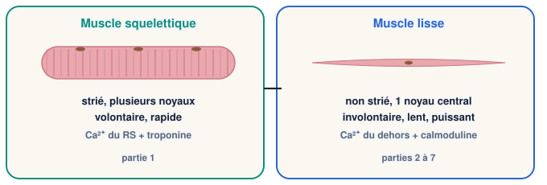
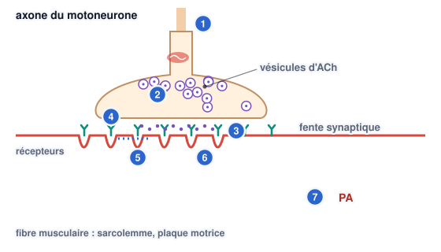
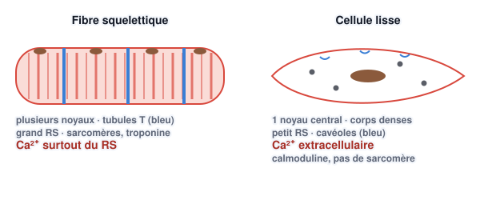
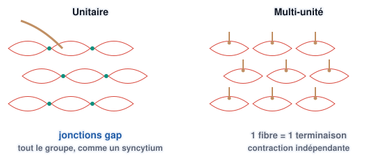
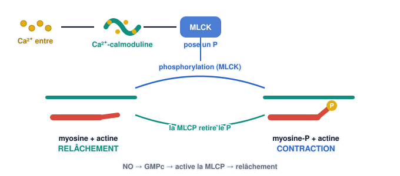
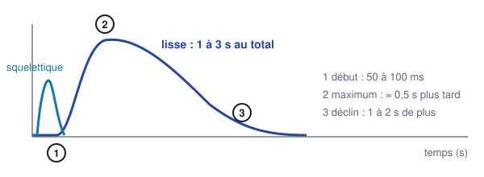
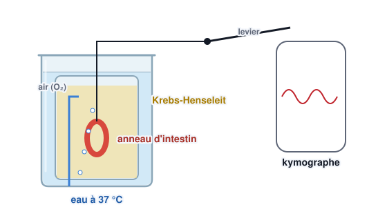
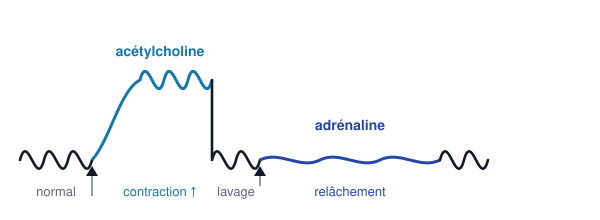

# Le muscle lisse, comparé au muscle squelettique

8 schémas. Pour en afficher un dans le chat : ``.

## 0. On part du muscle squelettique déjà vu au cours pour comprendre, par différence, le muscle lisse.

`https://cdn.jsdelivr.net/gh/alxhe3-lab/schemas-medecine@main/Physiologie/TP6/fig00-ce33167a.svg`

## 1. Où se passent les 7 étapes ?

`https://cdn.jsdelivr.net/gh/alxhe3-lab/schemas-medecine@main/Physiologie/TP6/fig01-2fabf7aa.svg`

## 2. Pourquoi la cellule lisse a-t-elle besoin du calcium du dehors ?

`https://cdn.jsdelivr.net/gh/alxhe3-lab/schemas-medecine@main/Physiologie/TP6/fig02-d4b4fe99.svg`

## 3. Qui est innervé : chaque fibre, ou le groupe ?

`https://cdn.jsdelivr.net/gh/alxhe3-lab/schemas-medecine@main/Physiologie/TP6/fig03-7c72e283.svg`

## 4. Qui allume, qui éteint la myosine ?

`https://cdn.jsdelivr.net/gh/alxhe3-lab/schemas-medecine@main/Physiologie/TP6/fig04-1581b037.svg`

## 5. Combien de temps dure une contraction lisse typique ?

`https://cdn.jsdelivr.net/gh/alxhe3-lab/schemas-medecine@main/Physiologie/TP6/fig05-5154e7a2.svg`

## 6. Comment l'anneau d'intestin écrit-il sa contraction ?

`https://cdn.jsdelivr.net/gh/alxhe3-lab/schemas-medecine@main/Physiologie/TP6/fig06-b1aa12d2.svg`

## 7. Que montre le tracé quand on ajoute l'acétylcholine, puis l'adrénaline ?

`https://cdn.jsdelivr.net/gh/alxhe3-lab/schemas-medecine@main/Physiologie/TP6/fig07-e92ca941.svg`
