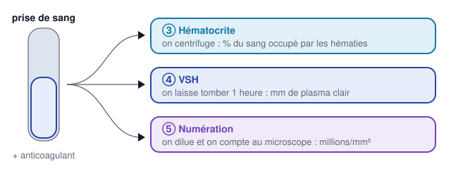
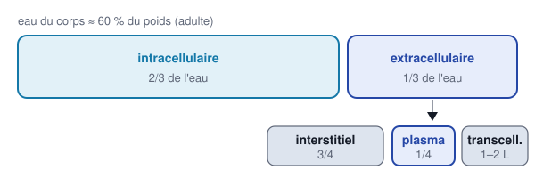
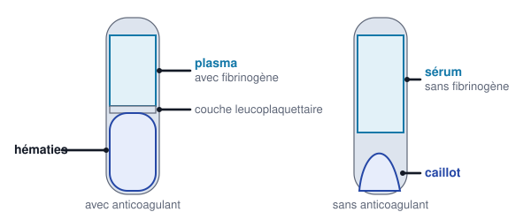
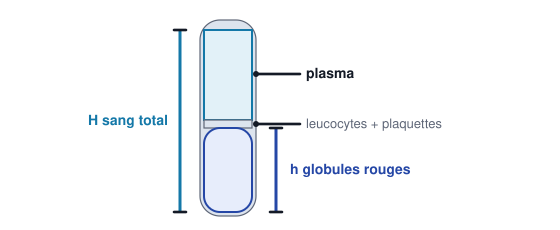
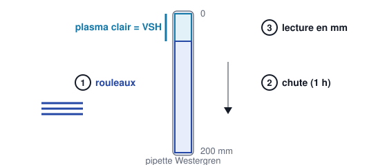
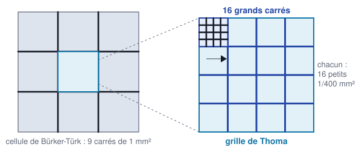
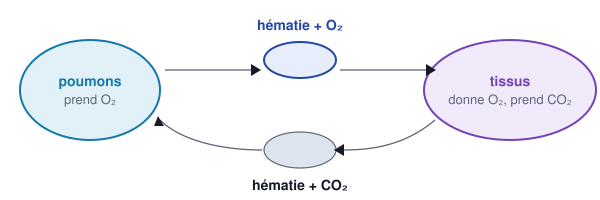

# Le sang : hématocrite, VSH, numération des hématies

8 schémas. Pour en afficher un dans le chat : ``.

## 0. Une prise de sang, trois mesures : les numéros renvoient aux parties.

`https://cdn.jsdelivr.net/gh/alxhe3-lab/schemas-medecine@main/Physiologie/TP7/fig00-80d47ecc.svg`

## 1. Comment l'eau du corps se partage-t-elle ?

`https://cdn.jsdelivr.net/gh/alxhe3-lab/schemas-medecine@main/Physiologie/TP7/fig01-86a2eaed.svg`

## 2. Même sang, deux tubes : qu'est-ce qui change ?

`https://cdn.jsdelivr.net/gh/alxhe3-lab/schemas-medecine@main/Physiologie/TP7/fig02-ff0a1bbe.svg`

## 3. Que mesure-t-on dans le tube ?

`https://cdn.jsdelivr.net/gh/alxhe3-lab/schemas-medecine@main/Physiologie/TP7/fig03-e35a154b.svg`

## 4. Les mêmes numéros dans la pipette Westergren

`https://cdn.jsdelivr.net/gh/alxhe3-lab/schemas-medecine@main/Physiologie/TP7/fig04-89456e51.svg`

## 5. Où compte-t-on ? La grille de Thoma

`https://cdn.jsdelivr.net/gh/alxhe3-lab/schemas-medecine@main/Physiologie/TP7/fig05-5c8b3ff8.svg`

## 6. Que transporte l'hémoglobine, et où ?

`https://cdn.jsdelivr.net/gh/alxhe3-lab/schemas-medecine@main/Physiologie/TP7/fig06-3f827070.svg`

## 7. Ce que demandent ces questions

`https://cdn.jsdelivr.net/gh/alxhe3-lab/schemas-medecine@main/Physiologie/TP7/fig07-5a97d2ab.svg`
