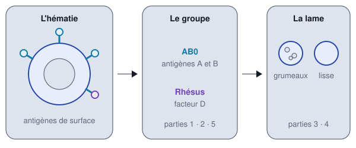
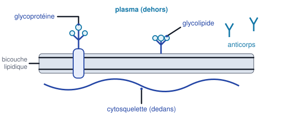
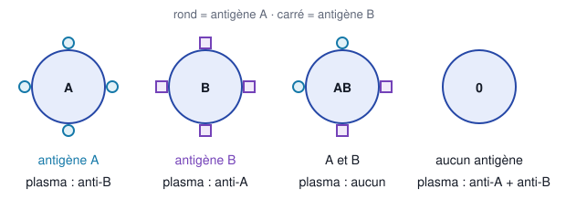
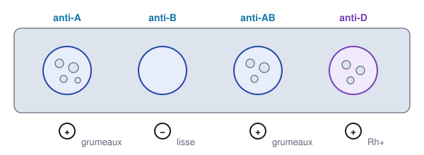
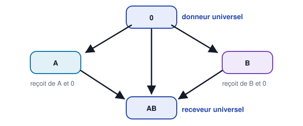
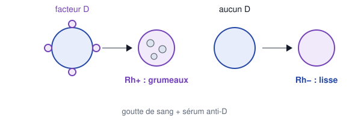
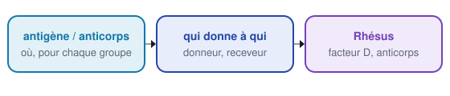

# Les groupes sanguins : AB0 et Rhésus

7 schémas. Pour en afficher un dans le chat : ``.

## 0. Le fil du cours : l'hématie porte des antigènes, ils donnent le groupe, et la lame les révèle par l'agglutination.

`https://cdn.jsdelivr.net/gh/alxhe3-lab/schemas-medecine@main/Physiologie/TP8/fig00-1206b06a.svg`

## 1. Où est l'antigène de groupe ? Sur la membrane de l'hématie

`https://cdn.jsdelivr.net/gh/alxhe3-lab/schemas-medecine@main/Physiologie/TP8/fig01-60226832.svg`

## 2. Chaque groupe : son antigène dessus, l'anticorps contre l'autre autour

`https://cdn.jsdelivr.net/gh/alxhe3-lab/schemas-medecine@main/Physiologie/TP8/fig02-0b62cb9a.svg`

## 3. Exemple : la lame d'un patient A Rh+

`https://cdn.jsdelivr.net/gh/alxhe3-lab/schemas-medecine@main/Physiologie/TP8/fig03-7a715fe9.svg`

## 4. Le sang va dans le sens des flèches

`https://cdn.jsdelivr.net/gh/alxhe3-lab/schemas-medecine@main/Physiologie/TP8/fig04-163dcf1c.svg`

## 5. Le sérum anti-D sur deux sangs

`https://cdn.jsdelivr.net/gh/alxhe3-lab/schemas-medecine@main/Physiologie/TP8/fig05-c5848cd4.svg`

## 6. Ce que demandent ces questions

`https://cdn.jsdelivr.net/gh/alxhe3-lab/schemas-medecine@main/Physiologie/TP8/fig06-e0f2a83a.svg`
