# Le sang : hémoglobine, paramètres dérivés et leucocytes

11 schémas. Pour en afficher un dans le chat : ``.

## 0. Une prise de sang, deux séries : les numéros renvoient aux parties.

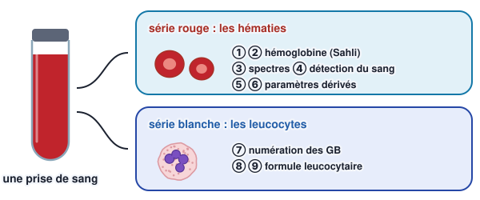

`https://cdn.jsdelivr.net/gh/alxhe3-lab/schemas-medecine@main/Physiologie/TP9/fig00-6877d815.svg`

## 1. Comment lit-on l'hémoglobine ? On dilue jusqu'à la même couleur.

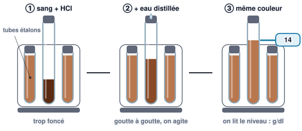

`https://cdn.jsdelivr.net/gh/alxhe3-lab/schemas-medecine@main/Physiologie/TP9/fig01-c6c31ed4.svg`

## 3. Où commence l'anémie ?

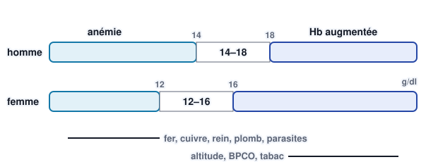

`https://cdn.jsdelivr.net/gh/alxhe3-lab/schemas-medecine@main/Physiologie/TP9/fig03-0005254c.svg`

## 4. Combien de bandes pour chaque forme ?

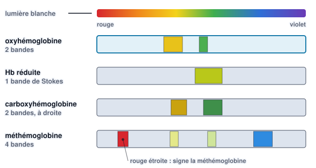

`https://cdn.jsdelivr.net/gh/alxhe3-lab/schemas-medecine@main/Physiologie/TP9/fig04-4e15a4c2.svg`

## 6. Comment le sang se trahit-il ?

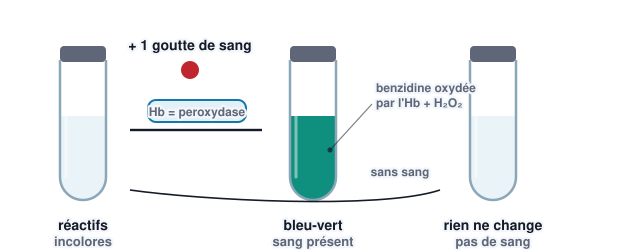

`https://cdn.jsdelivr.net/gh/alxhe3-lab/schemas-medecine@main/Physiologie/TP9/fig06-6cbe6921.svg`

## 8. Que dit le VEM ? Petites, normales ou grandes hématies

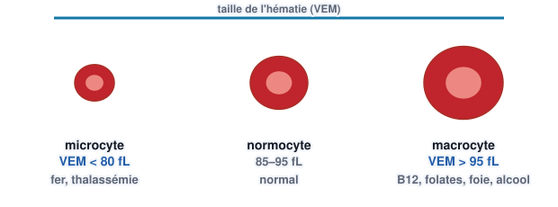

`https://cdn.jsdelivr.net/gh/alxhe3-lab/schemas-medecine@main/Physiologie/TP9/fig08-3b697457.svg`

## 9. Hypochrome ou hyperchrome : la couleur suit l'hémoglobine

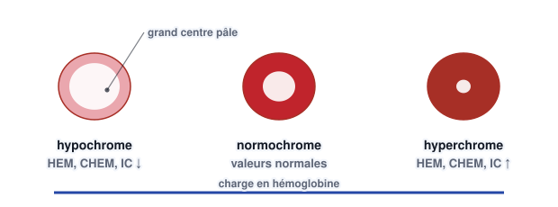

`https://cdn.jsdelivr.net/gh/alxhe3-lab/schemas-medecine@main/Physiologie/TP9/fig09-a005dfd3.svg`

## 10. Où compte-t-on, et quelles cellules ?

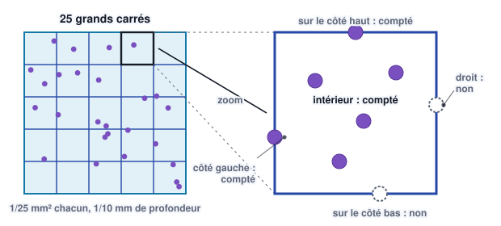

`https://cdn.jsdelivr.net/gh/alxhe3-lab/schemas-medecine@main/Physiologie/TP9/fig10-4d2594af.svg`

## 11. Comment reconnaître les 5 globules blancs ?

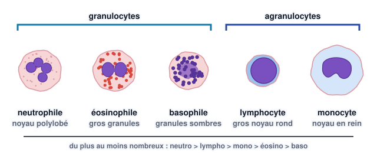

`https://cdn.jsdelivr.net/gh/alxhe3-lab/schemas-medecine@main/Physiologie/TP9/fig11-07d721a2.svg`

## 13. Que dit cette formule ? Chaque valeur sur sa zone normale

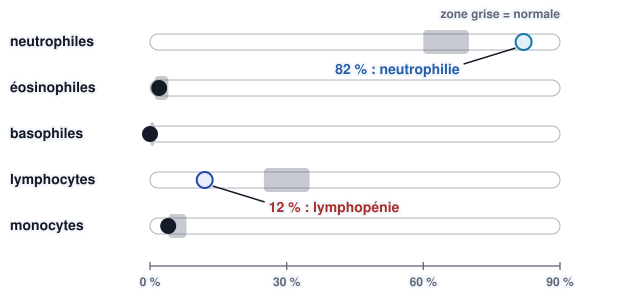

`https://cdn.jsdelivr.net/gh/alxhe3-lab/schemas-medecine@main/Physiologie/TP9/fig13-fde9d28e.svg`

## 14. Ce que demandent ces questions

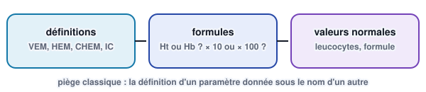

`https://cdn.jsdelivr.net/gh/alxhe3-lab/schemas-medecine@main/Physiologie/TP9/fig14-08a63b2e.svg`
