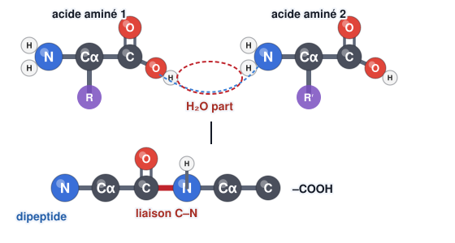
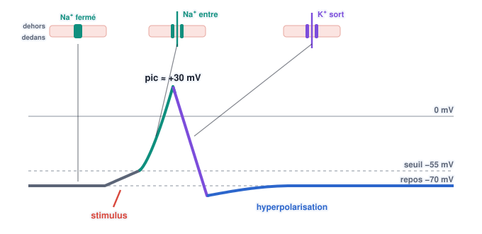
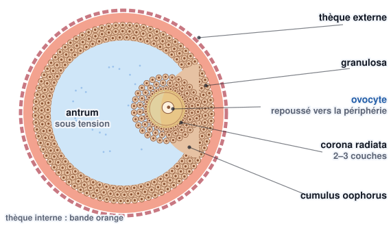

# Schémas de médecine en français 🩺

**425 schémas clairs et colorés** pour la 1re année de médecine : physiologie, biochimie, biophysique, anatomie et embryologie. En français, libres d'utilisation (CC BY 4.0).

Chaque schéma répond à une question (« Où se place le potentiel de repos, et pourquoi ? ») et se lit en quelques secondes : des couleurs qui ont un sens, des flèches, des étiquettes posées sur le dessin.

## Par matière

### Anatomie (102 schémas)

- [CM1 · Gamétogenèse et spermatogenèse](Anatomie/CM1/) : 13 schémas
- [CM2 · L'ovogenèse et le cycle](Anatomie/CM2/) : 11 schémas
- [CM3 · Fécondation et première semaine](Anatomie/CM3/) : 9 schémas
- [CM4 · Fin de la 2e semaine et 3e semaine](Anatomie/CM4/) : 10 schémas
- [CM5 · 4e semaine : somites, tube neural, crêtes](Anatomie/CM5/) : 7 schémas
- [CM6 · La 4e semaine : du disque au tube](Anatomie/CM6/) : 9 schémas
- [TP1 · S'orienter, la colonne, le thorax et l'épaule](Anatomie/TP1/) : 10 schémas
- [TP2 · Le membre supérieur libre : humérus, radius, ulna, main](Anatomie/TP2/) : 10 schémas
- [TP3 · L'os coxal](Anatomie/TP3/) : 10 schémas
- [TP4 · Le squelette du membre inférieur libre](Anatomie/TP4/) : 9 schémas
- [TP5 · Muscles de la ceinture scapulaire et du membre supérieur](Anatomie/TP5/) : 2 schémas
- [TP6 · Les muscles de la cuisse, de la jambe et du pied](Anatomie/TP6/) : 2 schémas

### Biochimie (134 schémas)

- [CM1 · Généralités : les bases de chimie du vivant](Biochimie/CM1/) : 15 schémas
- [CM2 · Peptides et protéines](Biochimie/CM2/) : 19 schémas
- [CM3 · Structure des protéines](Biochimie/CM3/) : 18 schémas
- [CM4 · Les enzymes](Biochimie/CM4/) : 8 schémas
- [CM5 · Cinétique enzymatique et inhibiteurs](Biochimie/CM5/) : 12 schémas
- [CM6 · Glycolyse et début de la néoglucogenèse](Biochimie/CM6/) : 14 schémas
- [CM7 · Cycle de Krebs, chaîne respiratoire et énergétique](Biochimie/CM7/) : 11 schémas
- [TP1 · Concentrations, osmolarité et perfusion](Biochimie/TP1/) : 9 schémas
- [TP3 · Le pH et la charge des acides aminés](Biochimie/TP3/) : 9 schémas
- [TP4 · Ioniser les acides aminés, puis prélever le sang](Biochimie/TP4/) : 11 schémas
- [TP5 · La catalase et les facteurs de l'activité enzymatique](Biochimie/TP5/) : 8 schémas

### Biophysique (81 schémas)

- [CM1 · La biophysique, science de frontière](Biophysique/CM1/) : 8 schémas
- [CM2 · Drépanocytose, Tchernobyl et imagerie](Biophysique/CM2/) : 12 schémas
- [CM4 · Méthodes d'étude : l'électrophorèse](Biophysique/CM4/) : 6 schémas
- [CM5 · Chromatographie, centrifugation, lyophilisation](Biophysique/CM5/) : 11 schémas
- [TP1 · Mesurer, convertir, résumer](Biophysique/TP1/) : 5 schémas
- [TP2 · Optique : les lentilles et l'œil](Biophysique/TP2/) : 9 schémas
- [TP3 · Radiométrie et dosimétrie](Biophysique/TP3/) : 6 schémas
- [TP4 · Transport actif et biopotentiels](Biophysique/TP4/) : 6 schémas
- [TP5 · L'analyse spectrale](Biophysique/TP5/) : 9 schémas
- [TP6 · L'osmose et le microscope optique](Biophysique/TP6/) : 6 schémas
- [TP7 · La dialyse et sa mesure par conductimétrie](Biophysique/TP7/) : 3 schémas

### Physiologie (108 schémas)

- [CM1 · Le vivant et l'homéostasie](Physiologie/CM1/) : 9 schémas
- [CM2 · Potentiels membranaires, canaux et pompes](Physiologie/CM2/) : 12 schémas
- [CM3 · Synapse et transmission neuromusculaire](Physiologie/CM3/) : 10 schémas
- [CM4 · La cellule musculaire striée et sa contraction](Physiologie/CM4/) : 12 schémas
- [CM5 · Le muscle lisse, puis la physiologie du sang](Physiologie/CM5/) : 12 schémas
- [CM6 · Hémoglobine, groupes sanguins et début de l'hémostase](Physiologie/CM6/) : 13 schémas
- [TP2 · Transport membranaire et résistance globulaire](Physiologie/TP2/) : 8 schémas
- [TP3 · Excitabilité et conduction du nerf et du muscle](Physiologie/TP3/) : 7 schémas
- [TP4 · EMG et chronaximétrie](Physiologie/TP4/) : 4 schémas
- [TP5 · La contraction du muscle squelettique](Physiologie/TP5/) : 5 schémas
- [TP6 · Le muscle lisse, comparé au muscle squelettique](Physiologie/TP6/) : 8 schémas
- [TP7 · Le sang : hématocrite, VSH, numération des hématies](Physiologie/TP7/) : 8 schémas

## D'où viennent-ils ?

Ils sont tirés de cours « optimisés » : pour chaque cours magistral ou TP, Claude (l'IA d'Anthropic) croise l'enregistrement du cours, les notes et les diapos, puis fait une page de révision illustrée. Ces schémas en sont extraits automatiquement, en SVG.

Ils suivent les cours d'une faculté francophone : vérifie toujours avec ton propre cours, ton prof a le dernier mot. Une erreur ? Ouvre une *issue*.

## Les utiliser

- **Dans un document ou une page web** : chaque schéma est un fichier `.svg` (net à toutes les tailles). Clique dessus, puis « Download raw file ».
- **Dans une conversation avec Claude** (outil de dessin du chat) : `" style="max-width:100%">`. Le schéma s'affiche à l'endroit exact de la réponse. C'est ce qu'utilise le skill [explication-claire](https://github.com/alxhe3-lab/claude-explain-like-chatgpt).
- `index.json` liste tous les schémas : matière, cours, légende, adresse.

## Licence

Schémas sous licence [Creative Commons BY 4.0](https://creativecommons.org/licenses/by/4.0/deed.fr) : tu peux les copier, les modifier et les partager, même en dehors des cours, en citant la source (« schemas-medecine, alxhe3-lab »).

Si ça t'aide pour tes révisions, une ⭐ aide d'autres étudiants à trouver le dépôt.

---

*425 diagrams for first-year medical students, in French: physiology, biochemistry, biophysics, anatomy. Free to use (CC BY 4.0).*
