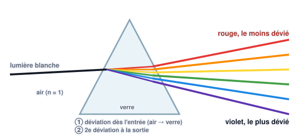

# Schémas de médecine en français

Je suis en 1re année de médecine. Pour réviser, je fais des fiches de chaque cours avec Claude, et chaque fiche a ses schémas. Plutôt que de les garder pour moi, je les mets tous ici : 471 pour l'instant, en physio, biochimie, biophysique, anatomie et embryo. Il y en a de nouveaux après chaque cours.

Chaque schéma répond à une question précise (genre « où se place le potentiel de repos, et pourquoi ? ») et se comprend en quelques secondes.

## Par matière

### Anatomie (124 schémas)

- [CM1 · Gamétogenèse et spermatogenèse](Anatomie/CM1/) : 13 schémas
- [CM2 · L'ovogenèse et le cycle](Anatomie/CM2/) : 11 schémas
- [CM3 · Fécondation et première semaine](Anatomie/CM3/) : 9 schémas
- [CM4 · Fin de la 2e semaine et 3e semaine](Anatomie/CM4/) : 10 schémas
- [CM5 · 4e semaine : somites, tube neural, crêtes](Anatomie/CM5/) : 7 schémas
- [CM6 · La 4e semaine : du disque au tube](Anatomie/CM6/) : 9 schémas
- [CM7 · Des semaines 5 à 8 au placenta](Anatomie/CM7/) : 9 schémas
- [CM8 · Placenta, liquide amniotique et sac vitellin](Anatomie/CM8/) : 8 schémas
- [TP1 · S'orienter, la colonne, le thorax et l'épaule](Anatomie/TP1/) : 10 schémas
- [TP2 · Le membre supérieur libre : humérus, radius, ulna, main](Anatomie/TP2/) : 10 schémas
- [TP3 · L'os coxal](Anatomie/TP3/) : 10 schémas
- [TP4 · Le squelette du membre inférieur libre](Anatomie/TP4/) : 9 schémas
- [TP5 · Muscles de la ceinture scapulaire et du membre supérieur](Anatomie/TP5/) : 2 schémas
- [TP6 · Les muscles de la cuisse, de la jambe et du pied](Anatomie/TP6/) : 2 schémas
- [TP7 · Vascularisation du membre supérieur](Anatomie/TP7/) : 5 schémas

### Biochimie (152 schémas)

- [CM1 · Généralités : les bases de chimie du vivant](Biochimie/CM1/) : 15 schémas
- [CM2 · Peptides et protéines](Biochimie/CM2/) : 19 schémas
- [CM3 · Structure des protéines](Biochimie/CM3/) : 18 schémas
- [CM4 · Les enzymes](Biochimie/CM4/) : 8 schémas
- [CM5 · Cinétique enzymatique et inhibiteurs](Biochimie/CM5/) : 12 schémas
- [CM6 · Glycolyse et début de la néoglucogenèse](Biochimie/CM6/) : 14 schémas
- [CM7 · Cycle de Krebs, chaîne respiratoire et énergétique](Biochimie/CM7/) : 11 schémas
- [CM8 · Glycogène et voie des pentoses phosphates](Biochimie/CM8/) : 10 schémas
- [TP1 · Concentrations, osmolarité et perfusion](Biochimie/TP1/) : 9 schémas
- [TP3 · Le pH et la charge des acides aminés](Biochimie/TP3/) : 9 schémas
- [TP4 · Ioniser les acides aminés, puis prélever le sang](Biochimie/TP4/) : 11 schémas
- [TP5 · La catalase et les facteurs de l'activité enzymatique](Biochimie/TP5/) : 8 schémas
- [TP7 · Dosage des transaminases (ALAT, ASAT)](Biochimie/TP7/) : 8 schémas

### Biophysique (87 schémas)

- [CM1 · La biophysique, science de frontière](Biophysique/CM1/) : 8 schémas
- [CM2 · Drépanocytose, Tchernobyl et imagerie](Biophysique/CM2/) : 12 schémas
- [CM4 · Méthodes d'étude : l'électrophorèse](Biophysique/CM4/) : 6 schémas
- [CM5 · Chromatographie, centrifugation, lyophilisation](Biophysique/CM5/) : 11 schémas
- [TP1 · Mesurer, convertir, résumer](Biophysique/TP1/) : 5 schémas
- [TP2 · Optique : les lentilles et l'œil](Biophysique/TP2/) : 9 schémas
- [TP3 · Radiométrie et dosimétrie](Biophysique/TP3/) : 6 schémas
- [TP4 · Transport actif et biopotentiels](Biophysique/TP4/) : 6 schémas
- [TP5 · L'analyse spectrale](Biophysique/TP5/) : 9 schémas
- [TP6 · L'osmose et le microscope optique](Biophysique/TP6/) : 6 schémas
- [TP7 · La dialyse et sa mesure par conductimétrie](Biophysique/TP7/) : 3 schémas
- [TP8 · La polarimétrie](Biophysique/TP8/) : 6 schémas

### Physiologie (108 schémas)

- [CM1 · Le vivant et l'homéostasie](Physiologie/CM1/) : 9 schémas
- [CM2 · Potentiels membranaires, canaux et pompes](Physiologie/CM2/) : 12 schémas
- [CM3 · Synapse et transmission neuromusculaire](Physiologie/CM3/) : 10 schémas
- [CM4 · La cellule musculaire striée et sa contraction](Physiologie/CM4/) : 12 schémas
- [CM5 · Le muscle lisse, puis la physiologie du sang](Physiologie/CM5/) : 12 schémas
- [CM6 · Hémoglobine, groupes sanguins et début de l'hémostase](Physiologie/CM6/) : 13 schémas
- [TP2 · Transport membranaire et résistance globulaire](Physiologie/TP2/) : 8 schémas
- [TP3 · Excitabilité et conduction du nerf et du muscle](Physiologie/TP3/) : 7 schémas
- [TP4 · EMG et chronaximétrie](Physiologie/TP4/) : 4 schémas
- [TP5 · La contraction du muscle squelettique](Physiologie/TP5/) : 5 schémas
- [TP6 · Le muscle lisse, comparé au muscle squelettique](Physiologie/TP6/) : 8 schémas
- [TP7 · Le sang : hématocrite, VSH, numération des hématies](Physiologie/TP7/) : 8 schémas

## Comment ils sont faits

Après chaque cours, Claude croise l'enregistrement, mes notes et les diapos du prof pour faire une fiche de révision illustrée. Les schémas sont extraits automatiquement de ces fiches le soir même.

Ils suivent les cours de ma fac, donc compare toujours avec ton propre cours : c'est ton prof qui a le dernier mot. Si tu vois une erreur, ouvre une issue, ça m'aide aussi.

## Les utiliser

Ce sont des fichiers SVG, donc nets à n'importe quelle taille. Tu peux les mettre dans tes fiches, tes présentations ou tes notes. `index.json` liste tout (matière, cours, légende, lien).

Tu peux aussi les afficher directement dans une conversation avec Claude, au milieu d'une explication : j'explique comment dans [claude-inline-images](https://github.com/alxhe3-lab/claude-inline-images).

## Licence

[CC BY 4.0](https://creativecommons.org/licenses/by/4.0/deed.fr) : tu peux les copier, les modifier et les partager, il faut juste citer « schemas-medecine, alxhe3-lab ».

Si ça t'aide pour tes révisions, une étoile fait plaisir et aide d'autres étudiants à tomber dessus.

---

*471 diagrams for first-year medical school, in French, made from my own revision sheets. New ones after every lecture. Free to use (CC BY 4.0).*
